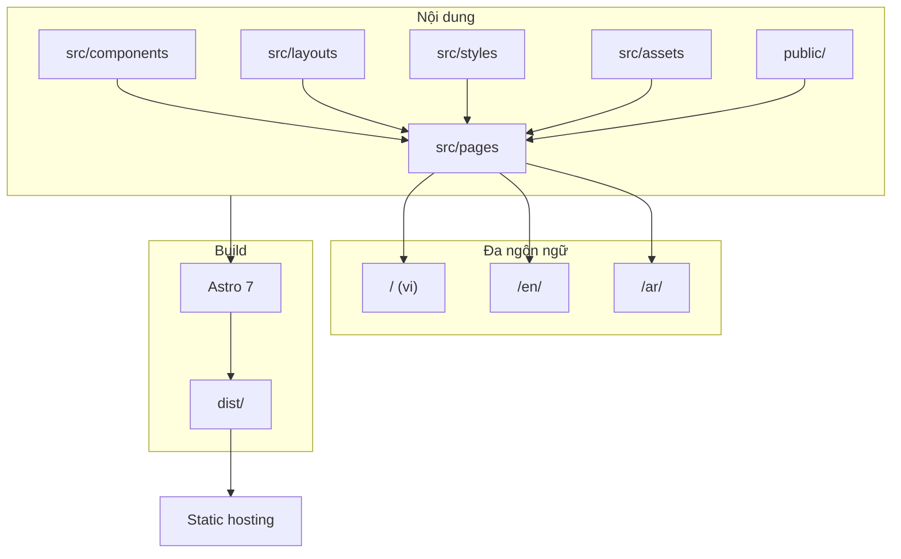
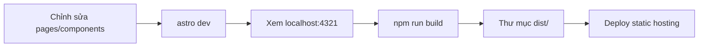

# roomieVerse Labs

Trang marketing và tài liệu nội bộ cho hệ sinh thái **roomieVerse Labs** — bộ ba sản phẩm hỗ trợ hành trình tìm chỗ ở, tìm người ở cùng và vận hành nhà trọ tại Việt Nam.

## Tổng quan

Repository này chứa website tĩnh (static site) giới thiệu **Roomio**, **roomieVerse** và **Roomibase**, cùng các trang pháp lý, đội ngũ và pitch deck Pre-Seed dành cho nhà đầu tư. Site được tối ưu tốc độ tải, responsive trên mobile, hỗ trợ dark/light mode và đa ngôn ngữ (Tiếng Việt, English, العربية).

## Hệ sinh thái sản phẩm

| Sản phẩm | Vai trò | Trạng thái / liên kết (từ nội dung site) |
|----------|---------|------------------------------------------|
| **Roomio** | Vận hành và quản lý phòng cho thuê — hợp đồng, hóa đơn, thu tiền, nhắc nợ và gửi bill tự động. | [roomio.roomieverse.me](https://roomio.roomieverse.me), demo [roomiodemo.roomieverse.me](https://roomiodemo.roomieverse.me) |
| **roomieVerse** | Tìm phòng share và bạn ở ghép trực tiếp, không qua trung gian. | [roomieverse.blog](https://roomieverse.blog) |
| **Roomibase** | Tìm phòng và nhà cho thuê nguyên căn. | Sắp ra mắt; giới thiệu trên `/roomieverse`; mục nav trỏ cùng route roomieverse |

Luồng hành trình trên trang chủ: (01) tìm nhà qua Roomibase → (02) ở ghép / bạn cùng phòng qua roomieVerse → (03) vận hành cho chủ nhà qua Roomio.

## Kiến trúc site



## Luồng phát triển và triển khai



## Công nghệ (tech stack)

| Thành phần | Chi tiết |
|------------|----------|
| Tên package | `roomio-ecosystem` (v0.0.1, private) |
| Framework | [Astro](https://astro.build) `^7.1.1` (static export, không adapter) |
| Cấu hình Astro | `defineConfig({})` — mặc định SSG → `dist/` |
| TypeScript | `extends astro/tsconfigs/strict` |
| Ngôn ngữ UI | Astro components; chuỗi i18n trong `Layout.astro` |
| Node.js | `>=22.12.0` |
| Phụ thuộc runtime | Chỉ `astro` (không thư viện UI framework riêng) |

### Scripts npm

| Script | Lệnh | Mục đích |
|--------|------|----------|
| `dev` | `astro dev` | Dev server local (foreground) |
| `build` | `astro build` | Build static site vào `dist/` |
| `preview` | `astro preview` | Xem bản production build local |

Ngoài `package.json`, `AGENTS.md` khuyến nghị `astro dev --background` và quản lý bằng `astro dev stop|status|logs`.

## Đa ngôn ngữ (i18n)

Locale mặc định là **Tiếng Việt** tại root (`/`). **English** dưới `/en/`, **العربية** dưới `/ar/` (RTL qua layout). Pitch deck chỉ có bản tiếng Việt, không có `/en/` hay `/ar/`.

| Locale | Prefix URL | Số trang marketing | Ghi chú |
|--------|------------|--------------------|---------|
| vi | `/` | 5 (+ pitch) | Trang chủ, sản phẩm, team, legal |
| en | `/en/` | 5 | Cùng cấu trúc với vi |
| ar | `/ar/` | 5 | RTL; cùng cấu trúc với vi |
| — | `/pitch-investor-rm-2026x` | 1 | Tiếng Việt; `noindex, nofollow`; không dùng `Layout` chung |

**Tổng:** 16 file route Astro → 16 trang HTML sau build.

## Cấu trúc repository

```
roomieVerse-Labs/
├── astro.config.mjs      # Cấu hình Astro
├── public/               # Tài nguyên tĩnh (favicon, brand, pitch hero, fonts, …)
├── src/
│   ├── assets/           # Asset xử lý qua Astro (ví dụ pitch slide 4)
│   ├── components/       # Component dùng chung
│   ├── layouts/          # Layout chính (i18n, theme, nav)
│   ├── pages/            # Route Astro (file-based routing)
│   │   ├── index.astro, roomio.astro, roomieverse.astro, …
│   │   ├── en/           # Bản tiếng Anh
│   │   ├── ar/           # Bản tiếng Ả Rập
│   │   └── pitch-investor-rm-2026x.astro
│   └── styles/           # CSS toàn site
└── AGENTS.md             # Hướng dẫn dev server (background mode)
```

| Khu vực `src/` | Số lượng / đường dẫn | Ghi chú |
|----------------|----------------------|---------|
| Pages | 16 file | Gồm pitch; routing theo file |
| Layouts | 1 | `Layout.astro` — header, nav, footer, chuỗi i18n |
| Components | 1 | `RoomieverseLabsLogo.astro` |
| Styles | 1 | `global.css` |
| Assets xử lý | `assets/pitch/slide-4/` | Glob ảnh/video cho slide 4 pitch |

### Ma trận route và trang

| Locale | URL | File nguồn | Nội dung chính |
|--------|-----|------------|----------------|
| vi | `/` | `src/pages/index.astro` | Trang chủ hệ sinh thái, hero, hành trình, thẻ sản phẩm |
| vi | `/roomio` | `src/pages/roomio.astro` | Marketing Roomio — carousel, bảng giá, CTA app/demo |
| vi | `/roomieverse` | `src/pages/roomieverse.astro` | roomieVerse + Roomibase (coming soon) |
| vi | `/our-team` | `src/pages/our-team.astro` | Đội ngũ |
| vi | `/legal` | `src/pages/legal.astro` | Chính sách bảo mật & điều khoản |
| vi | `/pitch-investor-rm-2026x` | `src/pages/pitch-investor-rm-2026x.astro` | Pitch deck Pre-Seed (standalone, noindex) |
| en | `/en/` | `src/pages/en/index.astro` | Homepage tiếng Anh |
| en | `/en/roomio` | `src/pages/en/roomio.astro` | Roomio (EN) |
| en | `/en/roomieverse` | `src/pages/en/roomieverse.astro` | roomieVerse / Roomibase (EN) |
| en | `/en/our-team` | `src/pages/en/our-team.astro` | Team (EN) |
| en | `/en/legal` | `src/pages/en/legal.astro` | Legal (EN) |
| ar | `/ar/` | `src/pages/ar/index.astro` | Homepage tiếng Ả Rập |
| ar | `/ar/roomio` | `src/pages/ar/roomio.astro` | Roomio (AR) |
| ar | `/ar/roomieverse` | `src/pages/ar/roomieverse.astro` | roomieVerse / Roomibase (AR) |
| ar | `/ar/our-team` | `src/pages/ar/our-team.astro` | Team (AR) |
| ar | `/ar/legal` | `src/pages/ar/legal.astro` | Legal (AR) |

Mục nav **Roomibase** trỏ tới `/roomieverse` (vi), `/en/roomieverse` (en), `/ar/roomieverse` (ar) — không có route riêng.

### Pitch deck (nội bộ)

- **Route:** [`/pitch-investor-rm-2026x`](src/pages/pitch-investor-rm-2026x.astro) — Pre-Seed pitch deck Roomio ($53,000 ask).
- **Lưu ý:** Trang có `noindex, nofollow`; không chia sẻ công khai nếu không cần thiết.

**12 slide chính** (+ khối Phụ lục accordion sau slide 12):

| # | Nhãn / chủ đề | `id` section | Tiêu đề trên slide (đại diện) |
|---|---------------|--------------|-------------------------------|
| 1 | Mở màn | — | Hệ thống tự động hoá giúp chủ nhà quản lý phòng cho thuê khoẻ re |
| 2 | Nỗi đau thị trường | `slide-2` | Thị trường không thiếu app quản lý, nhưng thiếu một trải nghiệm thực sự trơn tru |
| 3 | Giải pháp | `slide-3` | Không chỉ là phần mềm quản lý, roomio sẽ trở thành một luồng vận hành trơn tru |
| 4 | Sự thay đổi cách làm | `slide-4` | Một tháng của chủ cho thuê khi có "roomio" |
| 5 | Rào cản công nghệ | `slide-5` | Đối thủ phải đổi hết cách làm hiện tại mới có thể theo "roomio" |
| 6 | Demo | `slide-6` | Từ người mù công nghệ tới người rành công nghệ… ai cũng có thể dùng dễ dàng |
| 7 | Thị trường | `slide-7` | Cách "roomio" kiếm tiền |
| 8 | Chiến thuật | `slide-8` | Chiến thuật "Đánh Du Kích" & Hòn Tuyết Lăn |
| 9 | Kiểm chứng | — | Biến những lời hứa thành dữ liệu sử dụng thực tế |
| 10 | Đội ngũ | — | Đội ngũ Tinh gọn & Thực chiến |
| 11 | Hướng phát triển | — | Hoàn thiện "Quản gia tàng hình" trước khi bung sức |
| 12 | Kế hoạch vốn | `slide-12` | Biến sản phẩm thô thành "Cỗ máy kiếm khách" |

**Phụ lục (accordion)** — không có mục cho slide 6, 9, 10, 11:

| `id` phụ lục | Tiêu đề accordion |
|--------------|-------------------|
| `appendix-story` | Câu chuyện sản phẩm |
| `appendix-founder` | Người sáng lập |
| `appendix-slide-2` | Slide 2: Nỗi đau & Đối thủ |
| `appendix-slide-3` | Slide 3: Luồng vận hành trơn tru là gì? |
| `appendix-slide-4` | Slide 4: Một tháng của chủ cho thuê |
| `appendix-slide-5` | Slide 5: Kiến trúc |
| `appendix-slide-7` | Slide 7: Mô hình kinh doanh |
| `appendix-slide-8` | Slide 8: Chân dung khách |
| `appendix-slide-12` | Slide 12: Kế hoạch vốn và dự trù chi phí |

Media slide 4 (tùy chọn): đặt `card-1`…`card-3` dạng png/jpg/webp hoặc `card-N.mp4` trong `src/assets/pitch/slide-4/`. Hero/phụ lục pitch dùng asset tĩnh trong `public/pitch/`.

## Phát triển local

```sh
npm install
```

Khởi động dev server (khuyến nghị chạy nền theo `AGENTS.md`):

```sh
astro dev --background
```

Quản lý server nền:

```sh
astro dev status
astro dev logs
astro dev stop
```

Hoặc dùng script npm (foreground):

```sh
npm run dev
```

Mặc định: [http://localhost:4321](http://localhost:4321).

## Build và preview

```sh
npm run build
npm run preview
```

Artifact build nằm trong `dist/` (16 trang HTML: root, `en/`, `ar/`, pitch). Triển khai lên bất kỳ static host nào hỗ trợ upload thư mục build (Vercel, Netlify, Cloudflare Pages, S3 + CDN, …) — cấu hình deploy không nằm trong repo này.

## Liên hệ

roomieVerse Labs — [antt@roomieverselabs.com](mailto:antt@roomieverselabs.com)
