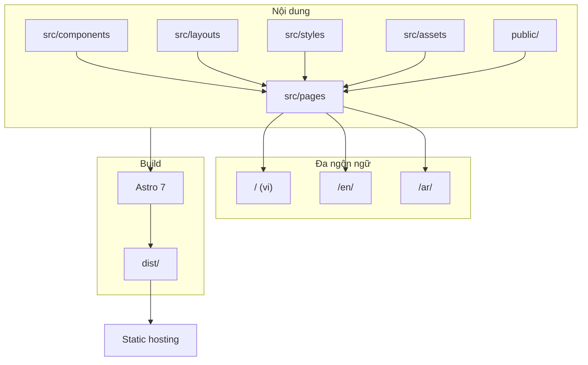
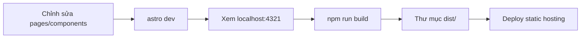

# roomieVerse Labs

Trang marketing và tài liệu nội bộ cho hệ sinh thái **roomieVerse Labs** — bộ ba sản phẩm hỗ trợ hành trình tìm chỗ ở, tìm người ở cùng và vận hành nhà trọ tại Việt Nam.

## Tổng quan

Repository này chứa website tĩnh (static site) giới thiệu **Roomio**, **roomieVerse** và **Roomibase**, cùng các trang pháp lý, đội ngũ và pitch deck Pre-Seed dành cho nhà đầu tư. Site được tối ưu tốc độ tải, responsive trên mobile, hỗ trợ dark/light mode và đa ngôn ngữ (Tiếng Việt, English, العربية).

## Hệ sinh thái sản phẩm

| Sản phẩm | Vai trò |
|----------|---------|
| **Roomio** | Vận hành và quản lý phòng cho thuê — hợp đồng, hóa đơn, thu tiền, nhắc nợ và gửi bill tự động. |
| **roomieVerse** | Tìm phòng share và bạn ở ghép trực tiếp, không qua trung gian. |
| **Roomibase** | (Sắp ra mắt) Tìm phòng và nhà cho thuê nguyên căn. |

## Kiến trúc site



## Luồng phát triển và triển khai



## Công nghệ

| Thành phần | Chi tiết |
|------------|----------|
| Framework | [Astro](https://astro.build) 7.x |
| Ngôn ngữ | TypeScript (cấu hình), Astro components |
| Node.js | >= 22.12.0 |
| Output | Static site (`astro build` → `dist/`) |

## Cấu trúc repository

```
roomieVerse-Labs/
├── astro.config.mjs      # Cấu hình Astro
├── public/               # Tài nguyên tĩnh (favicon, brand, …)
├── src/
│   ├── assets/           # Hình ảnh tối ưu (ví dụ pitch slides)
│   ├── components/       # Component dùng chung
│   ├── layouts/          # Layout chính (i18n, theme, nav)
│   ├── pages/            # Route Astro (file-based routing)
│   │   ├── index.astro, roomio.astro, roomieverse.astro, …
│   │   ├── en/           # Bản tiếng Anh
│   │   ├── ar/           # Bản tiếng Ả Rập
│   │   └── pitch-investor-rm-2026x.astro
│   └── styles/           # CSS toàn site
└── AGENTS.md             # Hướng dẫn dev server (background mode)
```

### Trang chính (Tiếng Việt)

| Đường dẫn | Mô tả |
|-----------|--------|
| `/` | Trang chủ hệ sinh thái |
| `/roomio` | Giới thiệu Roomio |
| `/roomieverse` | Giới thiệu roomieVerse |
| `/our-team` | Đội ngũ |
| `/legal` | Pháp lý |

Các bản `/en/*` và `/ar/*` tương ứng với cùng nội dung theo ngôn ngữ.

### Pitch deck (nội bộ)

- **Route:** [`/pitch-investor-rm-2026x`](src/pages/pitch-investor-rm-2026x.astro) — Pre-Seed pitch deck Roomio.
- **Lưu ý:** Trang có `noindex, nofollow`; không chia sẻ công khai nếu không cần thiết.

## Phát triển local

```sh
npm install
```

Khởi động dev server (khuyến nghị chạy nền theo `AGENTS.md`):

```sh
astro dev --background
```

Quản lý server nền:

```sh
astro dev status
astro dev logs
astro dev stop
```

Hoặc dùng script npm (foreground):

```sh
npm run dev
```

Mặc định: [http://localhost:4321](http://localhost:4321).

## Build và preview

```sh
npm run build
npm run preview
```

Artifact build nằm trong `dist/`. Triển khai lên bất kỳ static host nào hỗ trợ upload thư mục build (Vercel, Netlify, Cloudflare Pages, S3 + CDN, …) — cấu hình deploy không nằm trong repo này.

## Liên hệ

roomieVerse Labs — [antt@roomieverselabs.com](mailto:antt@roomieverselabs.com)
